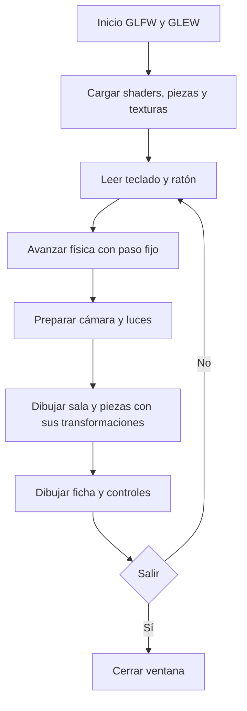

# Manual técnico — borrador de trabajo

## Objetivo y alcance

Integrar modelado, texturizado, iluminación, cámara y jerarquías de transformación
en un laboratorio educativo 3D. Incluye siete aparatos, cinco demostraciones
animadas, fachada, mobiliario y fichas. La implementación se apoya directamente en
las clases y shaders de la práctica 8.

## Flujo del programa

## Organización del código

- `main.cpp`: inicialización tomada como base de la práctica; funciones `room`,
  `apparatus`, `click` y `lights` agrupan arquitectura, modelos, interacción e iluminación.
- `Physics.h`: estado de las demostraciones e integración numérica.
- `src/base`: clases conservadas; `Model` usa Assimp y `Mesh` envía los datos a GPU.
- `parts.txt`: estación, nombre de pieza, padre lógico y pivote. El orden coloca
  padres antes que hijos. Las reglas específicas de animación están en `apparatus`.

Las mallas OBJ contienen coordenadas locales alrededor del pivote. OpenGL compone
la posición de la estación y la transformación de cada pieza. En el péndulo, el
segundo brazo hereda el marco del primero, compensando su ángulo para aplicar el
segundo ángulo absoluto. En la balanza, los platillos compensan el giro del brazo.
El manifiesto no es un importador genérico de escenas: la animación conoce los
nombres de estas piezas.

## Modelado y texturas

Las piezas usan primitivas de resolución moderada, bordes biselados y normales
suavizadas donde corresponde. `build_models.py` genera UV compartidas por estación,
hornea color difuso sin luces y oclusión ambiental con Cycles a 512 × 512. El mapa
final multiplica el color por `0.72 + 0.28 × AO`; las sombras móviles dependen de la
iluminación de OpenGL y no hay shadow mapping. Se conserva el AO por separado.

Se exportan OBJ/MTL por pieza para mantener pivotes sin cambiar el cargador del
curso. Los mapas se cargan con `stb_image`. El `.blend` conserva colecciones,
jerarquías y mapas empacados; los OBJ son la versión de ejecución.

## Animaciones

- Resorte: movimiento armónico de amplitud fija y frecuencia según configuración;
  escalado longitudinal de una hélice continua. Demostración ideal.
- Balanza: respuesta de segundo orden amortiguada hacia una inclinación objetivo.
  Es una representación del equilibrio, no una balanza calibrada.
- Van de Graaff: variable de carga que se aproxima gradualmente a 0 o 1; apertura
  radial de ocho tiras. No calcula campos eléctricos.
- Péndulo doble: ecuaciones no lineales para masas iguales, brazos de 0.65 m,
  gravedad 9.81 m/s² y RK4 con paso de 1/240 s.
- Poleas: coordenadas del nudo `(x,y)` y velocidades. Las alturas laterales se
  deducen de las distancias a los puntos de suspensión. Se resuelve una matriz de
  masa 2 × 2 con términos de curvatura y amortiguamiento. El giro de las poleas
  acompaña la longitud desplazada. El radio visual no modifica el modelo ideal de
  suspensión puntual; no se resuelve el contacto real cuerda–rueda.

Los dos últimos algoritmos sustentan la propuesta de animaciones complejas, sujeta
al criterio del profesor. La física utiliza tiempo fijo; el tiempo real acumulado
se limita por cuadro para evitar saltos grandes al mover o detener la ventana.

## Metodología y plan

Desarrollo incremental: conservar la base, integrar una versión ejecutable,
comprobar física, inspeccionar recursos y corregir la presentación.
El siguiente Gantt es un plan hasta la entrega, no un registro de horas ejecutadas.

| Actividad | 3 nov | 4 nov | 5 nov | 6 nov | 7 nov | 8 nov | 9 nov |
|---|---|---|---|---|---|---|---|
| Base e implementación inicial | X | | | | | | |
| Revisión de modelos y referencias | | X | X | | | | |
| Ajustes de interacción y animaciones | | | X | X | | | |
| Revisión visual y equipo de entrega | | | | X | X | | |
| Manuales, video y ensayo | | | | | X | X | |
| Comprobación y entrega | | | | | | | X |

## Limitantes y pendientes académicos

No hay colisiones de cámara, sombras dinámicas ni simulación óptica/electrostática
real. El microscopio muestra un esquema original. No se verificó Windows/Linux.
El acceso directo a estaciones es una ayuda de presentación, no movimiento físico.

Falta que el alumno complete portada, autores, conclusiones propias, referencias
aceptadas por el profesor y evidencia del proceso. La imagen de poleas proporcionada
sirvió de referencia de ese aparato; aún se deben definir las referencias de
fachada e interior exigidas en la rúbrica. No afirmar que capturas generadas del
propio programa reemplazan automáticamente esas referencias.

## Conclusiones preliminares

El prototipo permite observar cómo el modelado por piezas facilita animar aparatos
sin reexportarlos en cada cuadro. Las pruebas de física y la revisión visual cubren
aspectos diferentes: una simulación estable puede seguir teniendo un pivote o una
textura mal colocados. El alumno debe complementar esta sección con su evaluación
personal y los resultados finales de la exposición.
